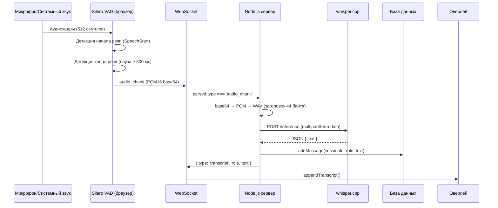

# Система распознавания речи в реальном времени (STT)

> **Модуль AI Helper** — подсистема захвата, детекции и транскрибации речи в реальном времени с двойным аудиопотоком (микрофон пользователя + системный звук собеседника).

**Дата актуализации:** 2026-08-26
**Статус:** ✅ Рабочая версия, протестирована

---

## 1. Обзор

Система обеспечивает:

- 🎤 Захват голоса пользователя через микрофон
- 🔊 Захват системного звука (голос собеседника) через `getDisplayMedia`
- 🧠 Детекцию речевой активности (VAD) на базе нейросети **Silero VAD v5**, работающей прямо в браузере через WebAssembly
- ✂️ Фильтрацию неречевых шумов (кашель, стук клавиш, музыка, уведомления)
- 📝 Транскрибацию выделенных речевых сегментов через локальный **whisper.cpp**
- 💾 Сохранение диалога в БД для последующей генерации подсказок
- 🖥️ Отображение транскриптов в перетаскиваемом оверлее

**Ключевые характеристики:**

| Параметр | Значение |
|----------|----------|
| Задержка «речь → текст» | 1–3 секунды |
| Частота дискретизации | 16 000 Гц |
| Формат аудио | PCM16, моно |
| Язык распознавания | Русский (с корректным захватом англ. терминов) |
| Локация вычислений | Полностью локальная (модели в браузере + локальные серверы) |

---

## 2. Архитектура

### 2.1 Схема потока данных

```
┌─────────────────────────── БРАУЗЕР (клиент) ───────────────────────────┐
│                                                                         │
│   ┌──────────────┐         ┌──────────────────────────────────┐         │
│   │  Микрофон    │────────▶│  MicVAD #1 (role: user)          │         │
│   │ getUserMedia │         │  Silero V5 + ONNX Runtime WASM   │         │
│   └──────────────┘         └──────────────┬───────────────────┘         │
│                                           │ onSpeechEnd                 │
│   ┌──────────────────┐     ┌──────────────▼───────────────────┐         │
│   │ Системный звук   │────▶│  MicVAD #2 (role: interlocutor)  │         │
│   │ getDisplayMedia  │     │  (кастомный getStream)           │         │
│   └──────────────────┘     └──────────────┬───────────────────┘         │
│                                           │                             │
│                              Float32 → Int16 → base64                   │
│                                           │                             │
│                              WebSocket /ws/ai-helper                    │
└───────────────────────────────────────────┼─────────────────────────────┘
                                            ▼
┌────────────────────────── СЕРВЕР (Node.js + Express) ──────────────────┐
│                                                                         │
│   ┌─────────────────┐    base64 → PCM → WAV (+44 байт заголовок)        │
│   │  aiHelperWs.js  │───────────────┬──────────────────────────────┐    │
│   │  (WebSocket)    │               │                              │    │
│   └─────────────────┘               ▼                              ▼    │
│                          ┌──────────────────┐          ┌────────────────┐│
│                          │ whisper.cpp      │          │ whisper.cpp    ││
│                          │ порт 8081        │          │ порт 8082      ││
│                          │ (user)           │          │ (interlocutor) ││
│                          └────────┬─────────┘          └────────┬───────┘│
│                                   └──────────┬──────────────────┘        │
│                                              ▼                          │
│                            ┌──────────────────────────────┐             │
│                            │ aiHelperController.js        │             │
│                            │ + aiHelperRepo.js (БД)       │             │
│                            └──────────────┬───────────────┘             │
│                                           │ transcript                  │
└───────────────────────────────────────────┼─────────────────────────────┘
                                            ▼
                              WebSocket → оверлей в браузере
```

### 2.2 Последовательность обработки речевого сегмента



---

## 3. Версии библиотек и компонентов

### 3.1 Клиентская часть (браузер)

| Компонент | Версия | Назначение | Примечание |
|-----------|:------:|------------|------------|
| `@ricky0123/vad-web` | **0.0.30** | Библиотека VAD для браузера | `bundle.min.js` |
| `onnxruntime-web` (встроенный в бандл) | **1.22.0** | Выполнение ONNX-моделей в WASM | Зашит внутри `bundle.min.js` |
| `ort-wasm-simd-threaded.mjs` | **1.22.0** | WASM glue-код | ⚠️ Должен совпадать с версией бандла |
| `ort-wasm-simd-threaded.wasm` | **1.22.0** | Бинарный модуль WASM | ~11 МБ |
| `silero_vad_v5.onnx` | **v5** | Основная модель детекции речи | 512 сэмплов/фрейм |
| `silero_vad_legacy.onnx` | **legacy** | Резервная модель | 1536 сэмплов/фрейм |
| `vad.worklet.bundle.min.js` | из 0.0.30 | AudioWorklet-процессор | Обязательно для режима `AudioWorklet` |

> ⚠️ **Критически важно:** версии `.wasm`/`.mjs` файлов должны **строго совпадать** с версией `onnxruntime-web`, встроенной в `bundle.min.js` (в текущей сборке — **1.22.0**). Несовпадение вызывает ошибки вида `Rb[a] is not a function` / `Aa is not a function` / `t.getValue is not a function`.

### 3.2 Серверная часть (Node.js)

| Компонент | Версия / источник | Назначение |
|-----------|-------------------|------------|
| **Node.js** | ≥ 18.x | Требуются глобальные `fetch`, `FormData`, `Blob` |
| **Express** | установленная в проекте | Раздача статики, COOP/COEP заголовки |
| **ws** (`WebSocketServer`) | установленная в проекте | WebSocket-сервер |
| **crypto** (встроенный) | — | Генерация `sessionId` (`crypto.randomUUID()`) |
| **fs / path** (встроенные) | — | Работа с временными WAV-файлами |

### 3.3 Внешние локальные сервисы

| Сервис | Адрес по умолчанию | Модель | Назначение |
|--------|--------------------|--------|------------|
| **whisper.cpp** (user) | `http://127.0.0.1:8081/inference` | whisper | Транскрибация голоса пользователя |
| **whisper.cpp** (interlocutor) | `http://127.0.0.1:8082/inference` | whisper | Транскрибация голоса собеседника |
| **llama.cpp** | `http://127.0.0.1:8080/v1/chat/completions` | `Qwen3.6-35B-A3B-UD-Q4_K_XL` | Генерация подсказок (не входит в STT, но использует его данные) |

> Два отдельных инстанса whisper.cpp позволяют параллельно обрабатывать оба аудиопотока без очереди.

---

## 4. Клиентская часть

### 4.1 Структура статических файлов (`public/`)

```
public/
├── ai-helper-overlay.html      # HTML оверлея
├── ai-helper.js                # Основная логика клиента
└── vad-assets/                 # Ассеты VAD и ONNX
    ├── bundle.min.js                   # @ricky0123/vad-web 0.0.30
    ├── vad.worklet.bundle.min.js       # AudioWorklet-процессор
    ├── ort-wasm-simd-threaded.mjs      # onnxruntime-web 1.22.0 (glue)
    ├── ort-wasm-simd-threaded.wasm     # onnxruntime-web 1.22.0 (бинарник)
    ├── silero_vad_v5.onnx              # Основная модель (используется)
    └── silero_vad_legacy.onnx          # Резервная модель
```

### 4.2 Подключение скриптов

В `ai-helper-overlay.html` подключаются **только**:

```html
<script src="/vad-assets/bundle.min.js"></script>
<script src="ai-helper.js"></script>
```

> ❌ **Не подключайте** отдельный `ort.min.js` — `bundle.min.js` уже содержит внутри себя полный код `onnxruntime-web`. Двойное подключение вызывает конфликт глобальных объектов.

### 4.3 Требования к заголовкам (обязательно!)

Для работы многопоточного WASM и `SharedArrayBuffer` сервер должен отдавать заголовки **Cross-Origin Isolation**. В `app.js` добавлен middleware:

```javascript
app.use((req, res, next) => {
    res.setHeader('Cross-Origin-Opener-Policy', 'same-origin');
    res.setHeader('Cross-Origin-Embedder-Policy', 'credentialless');
    next();
});
```

Проверка в консоли браузера:

```javascript
window.crossOriginIsolated  // должно быть true
typeof SharedArrayBuffer    // должно быть "function"
```

> Используется `credentialless` вместо `require-corp` — это позволяет продолжать загружать внешние ресурсы (картинки, скрипты с CDN) без явных CORS-заголовков.

### 4.4 Конфигурация VAD

Общие опции для обоих детекторов:

```javascript
const vadOptions = {
    baseAssetPath: "/vad-assets/",
    onnxWASMBasePath: "/vad-assets/",
    model: "v5",                     // "v5" → silero_vad_v5.onnx
    positiveSpeechThreshold: 0.5,    // порог начала речи
    negativeSpeechThreshold: 0.35,   // порог окончания речи
    redemptionMs: 800,               // пауза (мс) для завершения сегмента
    preSpeechPadMs: 300,             // буфер перед речью (мс)
    minSpeechMs: 300,                // мин. длительность сегмента (мс)
    ortConfig: (ort) => {
        ort.env.wasm.numThreads = 1; // однопоточный режим
        ort.env.wasm.simd = true;    // SIMD-инструкции
    }
};
```

> ⚠️ **Важно:** параметры `redemptionMs`, `preSpeechPadMs`, `minSpeechMs` задаются в **миллисекундах**. Варианты с суффиксом `Frames` в этой версии библиотеки **не поддерживаются**.

### 4.5 Создание двух детекторов

```javascript
// Микрофон пользователя
micVad = await vad.MicVAD.new({
    ...vadOptions,
    onSpeechEnd: (audio) => sendAudioChunkToServer('user', audio)
});

// Системный звук (собеседник) — через кастомный getStream
systemVad = await vad.MicVAD.new({
    ...vadOptions,
    getStream: async () => sysOnlyStream,  // уже созданный стрим из getDisplayMedia
    onSpeechEnd: (audio) => sendAudioChunkToServer('interlocutor', audio)
});
```

> ⚠️ В `@ricky0123/vad-web@0.0.30` **отсутствует** класс `AudioNodeVAD`. Для системного звука используется второй экземпляр `MicVAD` с переопределённой функцией `getStream`.

### 4.6 Сериализация аудио

Аудио передаётся как **сырой PCM16 в base64**. Во избежание `RangeError: Maximum call stack size exceeded` при кодировании больших буферов используется пакетное преобразование:

```javascript
const bytes = new Uint8Array(int16Array.buffer);
let binary = '';
const chunkSize = 0x8000; // 32768 байт за итерацию
for (let i = 0; i < bytes.length; i += chunkSize) {
    binary += String.fromCharCode.apply(null, bytes.subarray(i, i + chunkSize));
}
const base64 = btoa(binary);
```

---

## 5. Серверная часть

### 5.1 Компоненты

| Файл | Ответственность |
|------|-----------------|
| `src/ws/aiHelperWs.js` | WebSocket-сервер, маршрутизация сообщений, управление сессиями |
| `src/controllers/aiHelperController.js` | Обработка аудио (PCM→WAV), вызов whisper.cpp, генерация подсказок |
| `src/db/aiHelperRepo.js` | Персистентность сессий и сообщений |
| `src/utils/logger.js` | Модульный логгер с уровнями и цветами |

### 5.2 Протокол сообщений

**Клиент → сервер:**

| type | Поля | Назначение |
|------|------|------------|
| `audio_chunk` | `role`, `audioBase64`, `sampleRate`, `format`, `timestamp` | Речевой сегмент для транскрибации |
| `request_hint` | — | Запрос подсказки у LLM |
| `end_session` | — | Завершение сессии |

**Сервер → клиент:**

| type | Поля | Назначение |
|------|------|------------|
| `transcript` | `role`, `text`, `timestamp` | Готовый транскрипт |
| `hint_token` | `token` | Токен стриминга подсказки |
| `hint_done` | — | Подсказка завершена |
| `error` | `message` | Ошибка |

Поле `role` принимает значения:
- `user` — голос пользователя (микрофон)
- `interlocutor` — голос собеседника (системный звук)

### 5.3 Обработка аудио-чанка

```
1. base64 → Buffer (сырой PCM16)
2. Формируется WAV-заголовок (44 байта): 16000 Гц, моно, 16 бит
3. Buffer.concat([wavHeader, pcmBuffer]) → wavBuffer
4. wavBuffer сохраняется во временный файл (для отладки)
5. Отправка в whisper.cpp:
   const form = new FormData();                              // глобальный!
   const audioBlob = new Blob([wavBuffer], { type: 'audio/wav' });
   form.append('file', audioBlob, 'chunk.wav');
   form.append('language', 'ru');
   form.append('response_format', 'json');
   await fetch(url, { method: 'POST', body: form });
6. Парсинг ответа, сохранение в БД при непустом тексте
7. Отправка { type: 'transcript' } клиенту
8. Удаление временного файла (в finally)
```

> ⚠️ **Критическая деталь:** необходимо использовать **глобальный** `FormData` + `Blob` (встроены в Node.js 18+). npm-пакет `form-data` **некорректно сериализуется** глобальным `fetch`, что приводит к ошибке `no 'file' field in the request` на стороне whisper.cpp. Заголовок `Content-Type` указывать вручную не нужно — `fetch` сам проставит корректный `multipart/form-data` с `boundary`.

### 5.4 Обработка входящих сообщений

Библиотека `ws` передаёт данные в обработчик как `Buffer`, поэтому перед парсингом требуется конвертация:

```javascript
ws.on('message', async (data, isBinary) => {
    const messageString = data.toString('utf8');
    const parsed = JSON.parse(messageString);
    // ... маршрутизация по parsed.type
});
```

---

## 6. Конфигурация окружения

Переменные окружения (с дефолтными значениями):

| Переменная | Дефолт | Назначение |
|------------|--------|------------|
| `WHISPER_USER_URL` | `http://127.0.0.1:8081/inference` | whisper для микрофона |
| `WHISPER_INTERLOCUTOR_URL` | `http://127.0.0.1:8082/inference` | whisper для системного звука |
| `LLAMA_CPP_URL` | `http://127.0.0.1:8080/v1/chat/completions` | LLM для подсказок |
| `LOG_LEVEL` | `info` | Уровень логирования (`debug`/`info`/`warn`/`error`) |
| `LOG_COLORS` | `true` | Цветной вывод в консоль |

Временная директория для аудио: `<project>/temp_audio/` (создаётся автоматически, файлы удаляются после обработки).

---

## 7. Запуск системы

### 7.1 Предварительные требования

1. Запущенные инстансы **whisper.cpp** на портах `8081` и `8082`
2. Запущенный **llama.cpp** на порту `8080` (опционально, только для подсказок)
3. Сайт открыт на `localhost` или по `HTTPS` (обязательно для `crossOriginIsolated`)

### 7.2 Запуск

```bash
npm run start
# Сервер: http://localhost:3000
```

### 7.3 Использование

1. Открыть страницу с оверлеем AI Helper
2. Нажать **«▶ Начать захват»**
3. В диалоге выбора экрана **обязательно** поставить галочку *«Поделиться звуком вкладки/системы»*
4. Разрешить доступ к микрофону
5. Говорить — транскрипты появляются в оверлее с метками `[Я]` / `[Собеседник]`

---

## 8. Известные особенности и решённые проблемы

| Проблема | Причина | Решение |
|----------|---------|---------|
| `Rb[a] / Aa / t.getValue is not a function` | Несовпадение версий `.wasm` и `bundle.min.js` | Использовать WASM строго версии **1.22.0** |
| `Unable to load a worklet's module` | Отсутствует файл worklet | Скачать `vad.worklet.bundle.min.js` в `vad-assets/` |
| `Maximum call stack size exceeded` | `String.fromCharCode.apply` на больших массивах | Пакетное преобразование (чанки по 32 КБ) |
| `no 'file' field in the request` | npm `form-data` несовместим с глобальным `fetch` | Глобальный `FormData` + `Blob` |
| `SharedArrayBuffer` заблокирован | Отсутствуют заголовки изоляции | `COOP: same-origin` + `COEP: credentialless` |
| `Unknown message type: undefined` | `ws` отдаёт данные как `Buffer` | `data.toString('utf8')` перед `JSON.parse` |
| Речь не завершалась (`onSpeechEnd` не вызывался) | Не указан `redemptionMs` | `redemptionMs: 800` |
| `AudioNodeVAD is undefined` | Класс отсутствует в версии 0.0.30 | Второй `MicVAD` с кастомным `getStream` |

---

## 9. Настройка качества детекции

При необходимости адаптировать чувствительность:

| Параметр | Увеличить → | Уменьшить → |
|----------|-------------|-------------|
| `positiveSpeechThreshold` | Реже срабатывает (меньше ложных стартов) | Чаще срабатывает (риск шума) |
| `negativeSpeechThreshold` | Дольше ждёт окончания речи | Быстрее обрезает сегменты |
| `redemptionMs` | Длиньше пауза до завершения | Быстрее завершение (риск разрыва фраз) |
| `minSpeechMs` | Игнорирует короткие звуки | Ловит даже короткие реплики |

---

## 10. Производительность

По результатам тестирования:

- ✅ Задержка транскрибации: **1–3 с** (зависит от длины сегмента и загрузки whisper)
- ✅ Английские термины в русской речи распознаются корректно
- ✅ Неречевые звуки (кашель, стук клавиш, уведомления) **не попадают** в транскрипты
- ✅ Фоновая музыка и шумы эффективно отфильтровываются моделью Silero v5

---

## 11. Диагностика

**Проверка работоспособности в консоли браузера:**

```javascript
window.crossOriginIsolated        // true
typeof SharedArrayBuffer          // "function"
typeof vad                        // "object"
typeof vad.MicVAD                 // "function"
```

**Ожидаемые логи при успешном захвате:**

```
VAD | debug > Loading VAD...
VAD | debug > ...finished loading VAD
VAD | debug > started micVAD
[AI Helper] MicVAD (микрофон) started
[AI Helper] MicVAD (системный звук) started
[AI Helper] Dual VAD capture started successfully
```

**Проверка сервера:**

```bash
curl -I http://localhost:3000/vad-assets/ort-wasm-simd-threaded.mjs
# Должны присутствовать:
# Cross-Origin-Opener-Policy: same-origin
# Cross-Origin-Embedder-Policy: credentialless
```

---

*Документация актуальна для связки: `@ricky0123/vad-web@0.0.30` + `onnxruntime-web@1.22.0` + Silero VAD v5.*

Файлы библиотек 
https://app.unpkg.com/@ricky0123/vad-web@0.0.30/files/dist
https://app.unpkg.com/onnxruntime-web@1.29.0/files/dist

```

---

Документ полностью фиксирует:
- ✅ Все версии библиотек (критично для воспроизводимости сборки)
- ✅ Архитектуру и поток данных
- ✅ Протокол сообщений
- ✅ Конфигурацию окружения
- ✅ Все решённые проблемы (защита от повторения граблей при пересборке)